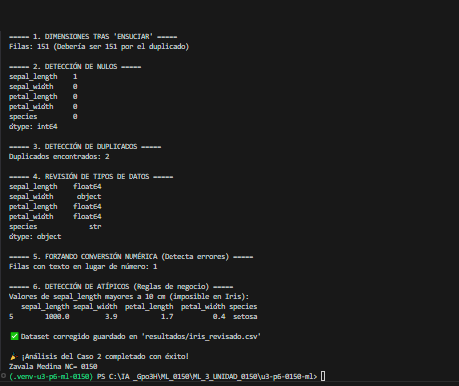
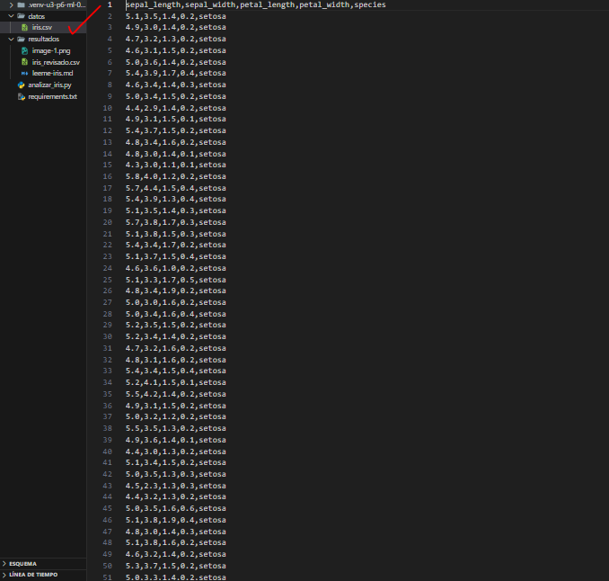
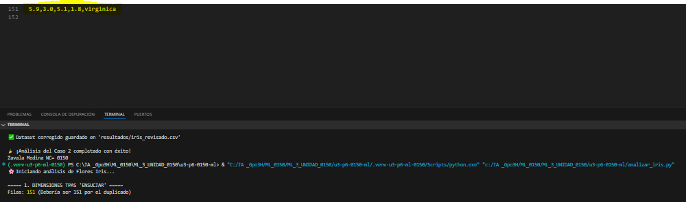
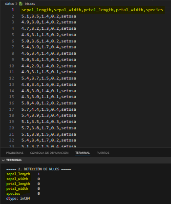
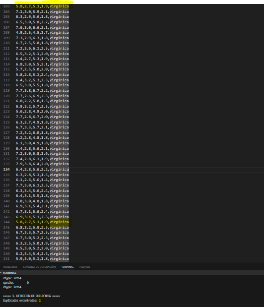
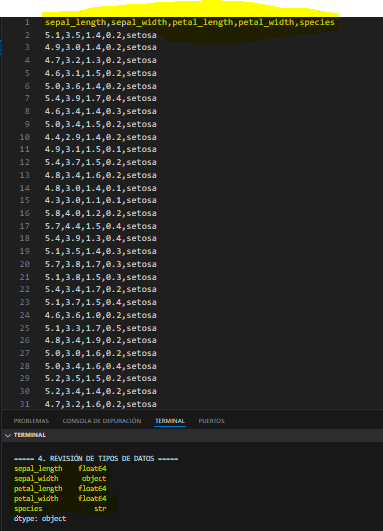
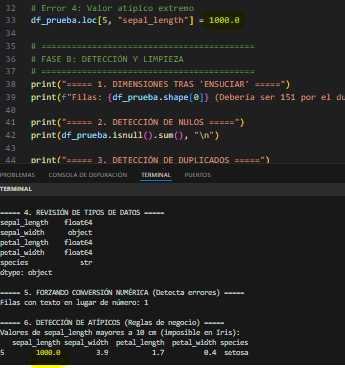

## Zavala Medina | NC= 0150
# 🕵️‍♂️ Práctica: Identificación de Problemas en los Datos

> **⏱️ Duración:** 2 horas  
> **🎯 Nivel:** Cero a principiante  
> **🤖 Área:** Machine Learning (Data Cleaning)  
> **💻 Herramientas:** Python, VS Code, Pandas, NumPy, Seaborn  

## Resultado de codigo

## Contenido del CSV

## Dimension tras "Ensuciar"

## Deteccion de Nulos

## Deteccion de duplicados 

## Revision de tipos de datos

## Deteccion de atipicos(Numero exagerado)
